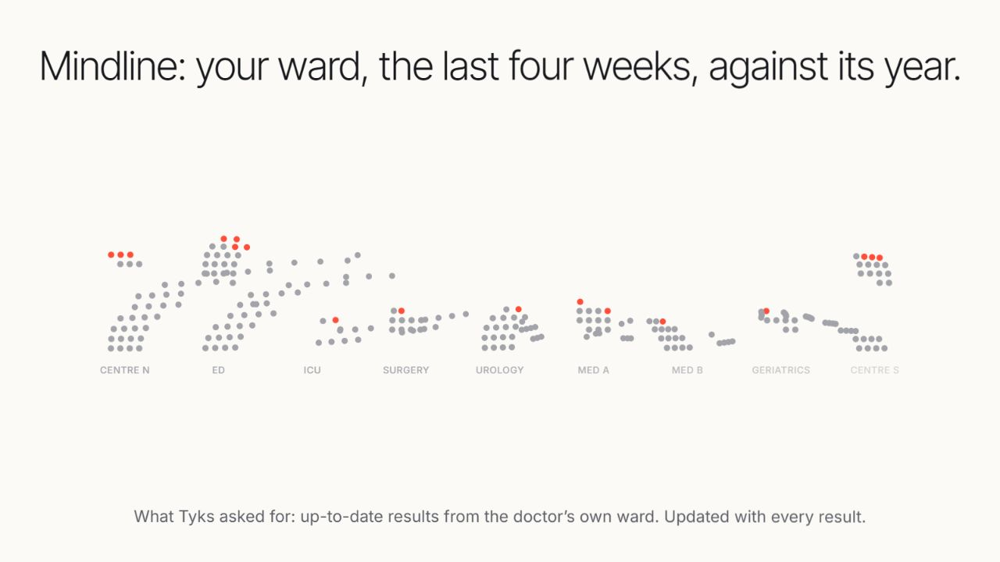
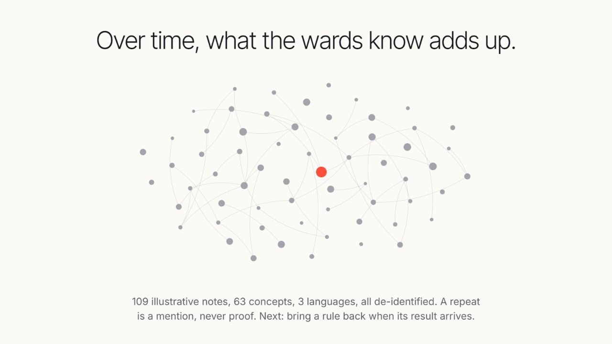
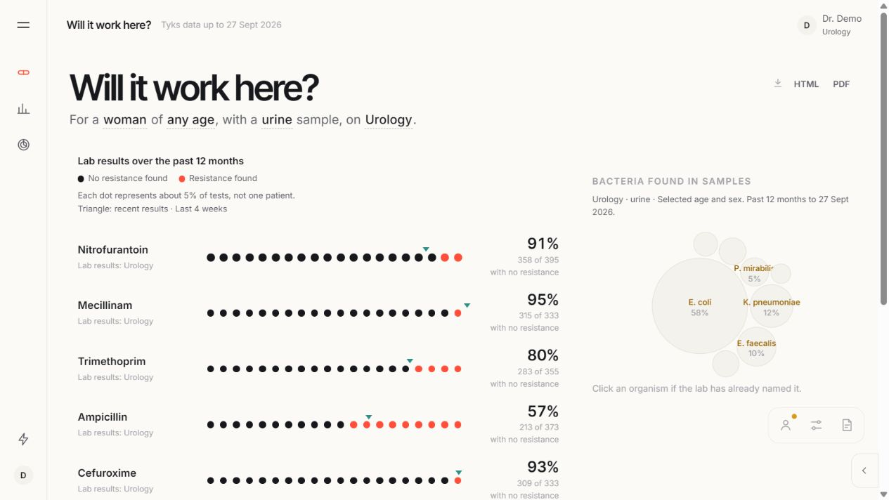
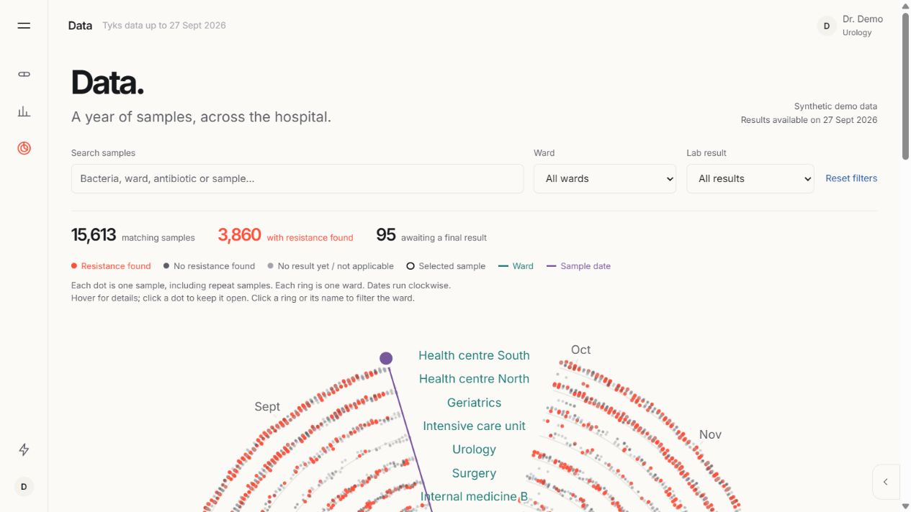

# Mindline

**Capturing the fingerprints of wisdom.**

Mindline connects local antimicrobial-resistance evidence with the reasoning clinicians share about patients. Doctors explore laboratory results, record what the next clinician should know and why, and contribute reusable concepts to a ward's knowledge. Hygiene teams follow changes across wards and investigate emerging patterns.

This repository contains the application, a complete browser-only edition, both interactive demo films, and the synthetic feed simulator. The repository remains private.

**[Open the live app](https://mindline-demo.calmpearl2.chatgpt.site/)** · **[Watch the interactive film](https://mindline-demo.calmpearl2.chatgpt.site/demo/)** · **[Open admin and knowledge](https://mindline-demo.calmpearl2.chatgpt.site/admin/)**

## Watch the demo

A 70-second walkthrough with an original instrumental soundtrack:

https://github.com/user-attachments/assets/1567df8d-34b4-4b7e-9903-309a3d1b925b

[Download the MP4](docs/media/mindline-demo.mp4). The attachment belongs to this private repository; viewers need repository access.



*Local laboratory results become an explorable picture of what is happening on the wards.*



*Clinician contributions accumulate into searchable concepts and relationships, with a tag-tree interface and local RDF/SPARQL support.*



*The doctor dashboard shows the selected patient group, organisms and laboratory resistance results.*



*The Data view keeps the circular visualization alongside searchable filters and readable summaries.*

## Explore locally

Build and serve the static edition from the repository root:

```sh
python static-site/build.py
python -m http.server 18973 --directory static-site/dist
```

Open `http://localhost:18973/` and choose the doctor or hygiene demo account. Explore `/admin/` for the knowledge library and simulator, `/demo/` for the latest interactive film, and `/demo-v2/` for the alternative film.

The generated `static-site/dist` directory can be served by an ordinary static host. It includes its data, fonts, libraries, films and 3D scene; no application server or external CDN is needed. The public demo above is hosted on Sites; the GitHub source remains private.

For the Python edition:

```sh
python -m pip install -r app/requirements.txt
python app/server.py 8800
```

## What is demonstrated

- Doctor and hygiene dashboards, searchable circular data views, patient histories, ward comparisons and exportable insights.
- Focused note capture with simulated dictation: **Thinks**, **Because**, **Decided**, and **If–Then** statements.
- 109 illustrative contributions in English, Finnish and Swedish, organized into a searchable tag tree with provenance and conditional relationships.
- Local RDF representation and SPARQL queries using bundled Oxigraph in the static edition.
- A replayable feed with delayed, corrected and pending results and 21 simulated scenarios.

This is a demonstration with synthetic clinical records, not a validated clinical decision tool. Note extraction uses deterministic demo rules, not an LLM. The static edition includes seven saved Ask answers; it does not generate new AI answers. Browser changes remain in local IndexedDB and are not shared between users. Demo sign-in selects a role and is not access control.

## Repository layout

| Folder | Contents |
| --- | --- |
| `app/` | Python application, frontend, tests, saved answers, both films and 3D scene |
| `static-site/` | Browser runtime, vendored dependencies, build and parity tests |
| `data/` | Synthetic dataset and its documentation |
| `data-prep/` | Feed simulator, parameter summaries and preparation scripts |
| `docs/` | Architecture, source attribution and demo media |
| `tools/media/` | Recording, encoding and original music tooling |

The folder layout is intentional: build and application code resolve resources relative to the repository root. Downloaded external datasets, prototypes, research, local stores and generated build outputs are excluded.

## Verification and provenance

The static runtime passed 65 API fixture comparisons plus six note cases against Python, simulator checks for all 21 scenarios, and package checks for local assets and subfolder hosting. The knowledge checks cover the illustrative corpus, queries, conditional extraction and persistence.

See [static build instructions](static-site/README.md), [application guide](app/README.md), [architecture](docs/ARCHITECTURE.md), and [data sources and attribution](docs/DATA-SOURCES.md). Retain the included data and dependency notices. External MIMIC-IV and ARMD downloads must not be published with this repository.
