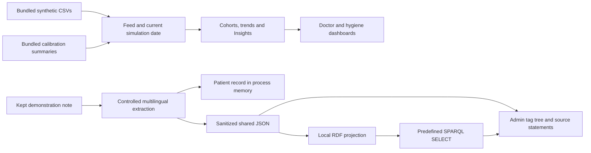

# Mindline architecture

Mindline is a private, synthetic-data demonstration with two execution modes. The Python server is the reference implementation; the static build runs equivalent product workflows inside the browser. Neither mode connects to a live hospital system.

## Source layout

| Directory | Responsibility |
| --- | --- |
| `app/` | Python API, cohort calculations, Insights, note extraction, local knowledge/RDF and tests |
| `app/static/` | Shared HTML, CSS and JavaScript UI; doctor, hygiene and admin views; interactive films |
| `data/synthetic_microbiology_dataset/` | Six supplied synthetic CSV tables, retained without cleaning in place |
| `data-prep/simulator/` | Feed generator, staged result delivery, corrections, scenarios and embedded admin UI |
| `data-prep/outputs/` | Small calibration summaries used by the simulator; no external patient-level download is needed at runtime |
| `static-site/runtime/` | Browser worker implementations of APIs and calculations |
| `static-site/vendor/` | Local charting, 3D and font assets with third-party notices |
| `static-site/tests/` | Reference fixtures, parity checks, integration checks and package checks |
| `docs/` | Product architecture, provenance and presentation assets |

There is no React build, application database server or mandatory cloud service. The minimal Python application dependency is RDFLib, declared in `app/requirements.txt`; its dependencies are installed by pip. Node.js is used for JavaScript checks and static runtime tests, not to run the Python application. Optional live Ask additionally needs a configured Codex CLI; cache-only mode is the default.

## Python server

`app/server.py` serves the shared UI and `/api/app/*`, and mounts the feed simulator at `/admin/sim/`. It binds to loopback by default. Demo role selection is a presentation flow, not authentication or an authorization boundary.



`feed.py` applies delivered rows and revisions as of the simulation date. `evidence.py`, `insights.py` and `overview.py` calculate their own explicit populations. The circular Data clock counts samples; antibiograms use first-isolate cohorts. These denominators are intentionally different.

### Note and knowledge storage

The note UI simulates dictation; it neither requests microphone access nor captures audio. English, Finnish and Swedish examples pass through a deterministic vocabulary/rule parser. It preserves recognized thoughts, stated reasons, decisions and conditional proposals. It is not a general language model, and unsupported wording may remain unclassified.

On the server, original note sentences and authors stay in the separate in-memory patient record and disappear after restart. Recognized shared concepts are persisted to `app/.runtime/knowledge.json`, with anonymous contribution IDs and dates reduced to reporting months. The shared graph does not receive patient identifiers, authors, exact dates or original patient free text. Original wording is available only for explicitly prewritten illustrative seeds. The legacy in-memory ward store is separate from the persistent admin graph.

`knowledge_rdf.py` derives `app/.runtime/knowledge.ttl` from the canonical sanitized JSON. RDF uses local identifiers, SKOS tags and attributed statement provenance. Conditions and reported rationales are not asserted as universal clinical facts. Four allowlisted questions run actual SPARQL SELECT queries through RDFLib; validated filter values are bound rather than concatenated into arbitrary query text. There is no remote SPARQL service or claimed Wikidata alignment.

### Ask and exports

Ask uses saved aggregate-based examples by default. Optional live mode sends an aggregate digest to a configured local Codex CLI and validates returned chart specifications. It does not let model text execute application code. Live jobs are bounded and can be stopped from admin.

Dashboard and individual Insights exports generate local HTML or use the browser print dialog for PDF. They are snapshots, not a transfer to a document service. Knowledge querying is a separate local workflow.

## Static browser mode

`static-site/build.py` packages the shared interface, bundled source data, calibration summaries, demonstration answers and browser runtime into `static-site/dist/`. The distribution can be served from a local HTTP server or a private static host, including a subdirectory. Opening the files directly with `file://` is not the supported launch mode.

`runtime/bridge.js` intercepts the UI's API-shaped requests and routes them to a Web Worker. The worker loads the bundled compressed source once, calculates responses locally and saves state to IndexedDB. The embedded simulator shares the parent worker. Profile/preferences use browser storage as well. Saved demonstration patient notes also belong to this browser state and can survive refreshes; this differs from the Python server’s in-memory patient record. This is browser-local state: it is not shared across users, browsers, devices or the Python server. Clearing site data removes it; unavailable or full browser storage falls back to tab-lifetime state with a visible warning.

The static knowledge implementation uses the same controlled extraction and attributed graph model, with real SPARQL execution through bundled Oxigraph WebAssembly. Its source statements and state belong to that browser; it does not create the Python server's `.ttl` file. The static build seeds only prewritten illustrations and never incorporates a developer's `.runtime` knowledge store.

Static Ask is limited to bundled saved examples; it does not invoke the Codex CLI or a remote model. A modern browser with module workers, WebAssembly, IndexedDB and gzip decompression support is required. WebGL enables the optional sign-in scene; the application has a non-WebGL fallback.

Python and JavaScript random generators differ. The same scenario and seed need not produce byte-identical random feeds in both modes. Deterministic calculations are compared against common input fixtures; simulation tests check reproducibility within a runtime, scenario behavior and replay integrity.

## Development checks

```powershell
python -m pip install -r app/requirements.txt
python -m unittest discover -s app -p "test_*.py" -v
python static-site/build.py
python static-site/tests/reference.py
node static-site/tests/parity.mjs
node static-site/tests/integration.mjs
python static-site/tests/package.py
```

Generated distributions, parity fixtures, test archives, recordings and `.runtime` state are not canonical source data. Keep them out of commits unless a particular release artifact is intentionally selected. Do not add downloaded external datasets, secrets or personal demo notes to the repository. See [Data sources](DATA-SOURCES.md) for provenance and license boundaries.
